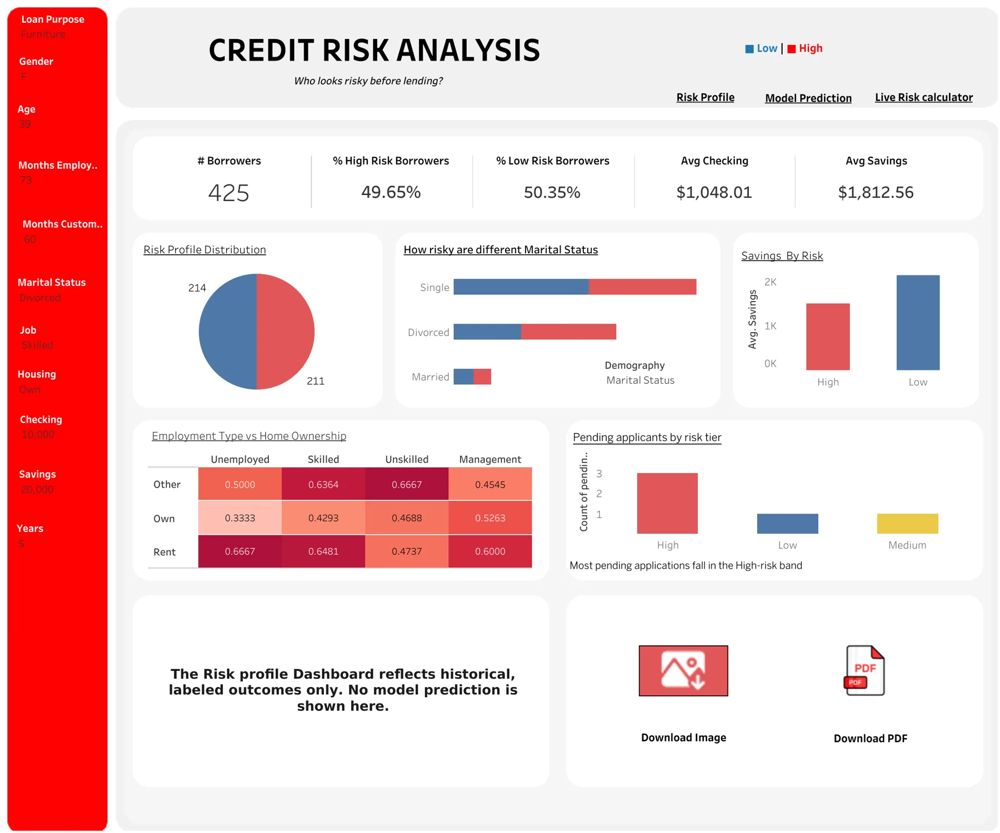
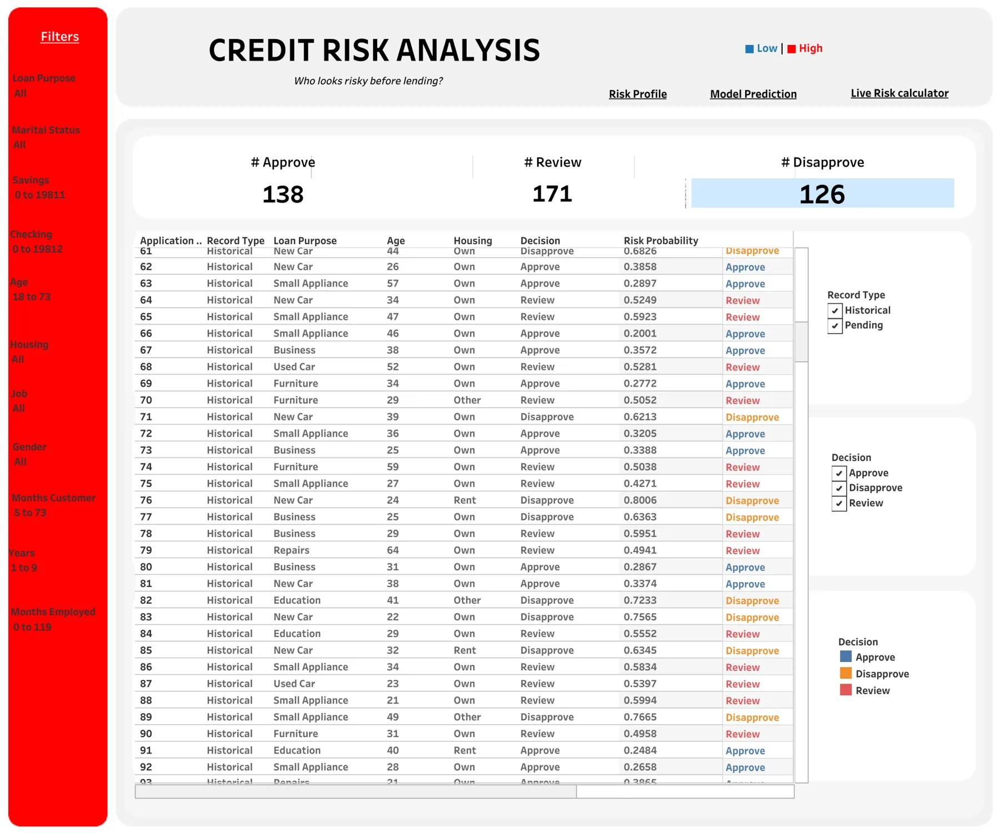
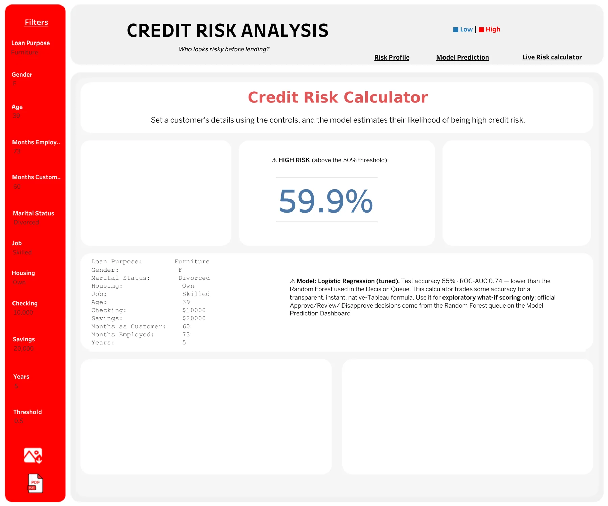

# Credit Risk Classification

**A model that predicts whether a borrower is high or low credit risk, plus a three-tab Tableau dashboard that turns the predictions into something a loan officer could use: a risk profile of past borrowers, an approve / review / disapprove queue, and a live what-if calculator.**

*Tools: Python · pandas · scikit-learn · matplotlib / seaborn · Tableau Public*



## The question

Who looks risky before lending? A lender has 425 past borrowers, each one labeled high or low credit risk, and new applications coming in. I wanted to know two things:

1. **How much can a basic customer profile tell you about risk?** That means balances, how long someone has been a customer, how long they've been employed, and what the loan is for.
2. **How do you show a model's output to the person making the call** without making it look more certain than it is?

Course project for ISM 6358 [FULL COURSE NAME], Seattle Pacific University, Aug 2026.

## Data

- **Source:** Dataset, provided for the course. [no public source]
- **Size:** 425 past borrowers, 11 features plus the High / Low risk label. The classes are balanced (211 high, 214 low) and nothing is missing
- **Features:** loan purpose, checking balance, savings balance, months as a customer, months employed, gender, marital status, age, housing, years, job
- **Not in this repo:** the data file. It came with the course and I couldn't find a license that lets me share it. To run the notebook, put `Credit Risk Data.xlsx` in `data/`

## Methods

### 1. Exploratory analysis
I looked at each feature on its own, then against risk, then checked correlations. Checking and savings balances are heavily right-skewed, and about 59% of customers have zero in checking. High-risk borrowers hold lower balances and have shorter employment, but they've been customers *longer* (about 26 months vs. 20). The numeric features barely correlate with each other, so I kept all of them.

### 2. Feature engineering
I added two features:
- **`savings_per_age`:** savings divided by age. A 25-year-old with $5,000 saved is in a different spot than a 60-year-old with the same balance
- **`has_checking`:** a 0/1 flag for having any checking balance, since the zero-balance group is so large

Together they raised the cross-validated AUC averaged across models from about 0.651 to 0.663.

### 3. Preprocessing
High risk = 1, low risk = 0. Categorical features were one-hot encoded (25 features in total), then an 80/20 stratified split gave 340 training rows and 85 test rows. The scaler was fit on the training data only, so nothing from the test set leaked in.

### 4. Models
I compared 10 classifiers with light tuning: logistic regression, random forest, gradient boosting, extra trees, AdaBoost, SVM, KNN, decision tree, naive Bayes and XGBoost. Each was scored with 5-fold cross-validated ROC-AUC on the training set, then on the held-out test set for accuracy, precision, recall, F1 and ROC-AUC.

### 5. Tableau export and dashboard
The best model (random forest) scored all 425 borrowers. The export keeps the original, readable values and adds the predicted risk, the risk probability, and a train/test flag, so the dashboard can show accuracy on test rows only. For the calculator I refit a logistic regression on the raw (unscaled) features, so its coefficients could go straight into a Tableau calculated field and update live as you move the controls.

| | |
|---|---|
|  |  |
| **Model prediction:** every application sorted into approve, review or disapprove, with its risk probability | **Live risk calculator:** set a customer's details and get their probability of being high risk. It states its own accuracy and limits |

## Key result

> **The best model, a random forest, ranks a high-risk borrower above a low-risk one about 76% of the time on held-out data (ROC-AUC 0.76, accuracy 68%). That's good enough to sort applications, not to decide them, so the dashboard sends the uncertain middle to a person instead of forcing a yes or no.**

- **The models were close.** Cross-validated AUC ranged from 0.57 to 0.66. On the test set, random forest led at 0.764, followed by SVM (0.740), AdaBoost and XGBoost (0.735) and logistic regression (0.731).
- **What it catches and misses:** the random forest caught 60% of the high-risk borrowers in the test set, and when it flagged someone as high risk it was right 71% of the time. In lending the expensive mistake is approving someone who defaults, which is why the queue has a review band.
- **Strongest signals:** months as a customer, age, savings per age, months employed and savings. The engineered `savings_per_age` came in third.
- **The queue:** 138 approve, 171 review, 126 disapprove.
- **The calculator** uses logistic regression: 65% accuracy on test data, ROC-AUC 0.74. That's a step below the random forest, and it's what you give up for a formula that's transparent and runs live in Tableau. It says on the dashboard that it's for exploring what-ifs, not final decisions.

**Limitations:** 425 rows is small. The test set is 85 rows, so each misclassified borrower moves accuracy by about 1.2 points. This is a teaching dataset, not a real lender's book.

## What I'd do differently

- **Take gender and marital status out, or at least audit for them.** I kept them as features because they carried signal (female applicants were labeled high risk 58% of the time vs. 46% for men). But US fair lending law (the Equal Credit Opportunity Act) bars using sex or marital status in credit decisions. A real version needs them removed and a check for whether other features stand in for them.
- **Score the calculator model in the notebook too.** Every number on the dashboard should trace back to a cell.
- **Fit the calculator on scaled features and convert back.** Fitting on raw balances threw a convergence warning. Fitting on standardized features and folding the means and standard deviations into the coefficients gives the same kind of Tableau formula without that problem.

## View it

- **No install:** [interactive dashboard on Tableau Public](https://public.tableau.com/views/CreditRiskAnalysis-ISM6358/RiskProfile) · screenshots in [`images/`](images/) · the [notebook](notebook/credit_risk_classification.ipynb) shows on GitHub with all its outputs and charts
- **To run it:** install the packages with `pip install -r requirements.txt`, put the data file in `data/`, then run `notebook/credit_risk_classification.ipynb` from inside the `notebook/` folder

## Repo layout

```
├── notebook/
│   └── credit_risk_classification.ipynb   # EDA, features, 10 models, Tableau export
├── images/                                # dashboard screenshots
├── requirements.txt                       # Python packages
└── data/                                  # not committed: put the course data file here
```

---
*Brenda Kinoti · [Portfolio](https://brendakinoti-datascientist.netlify.app) · MS Data Analytics & Business, Seattle Pacific University*
